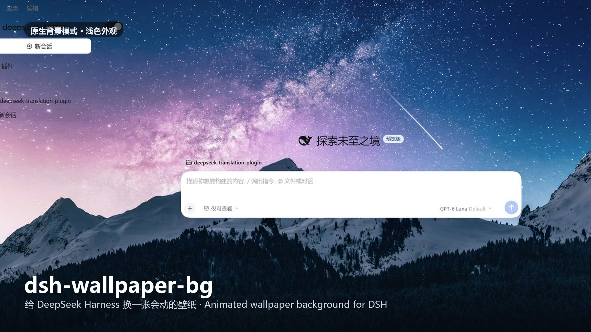
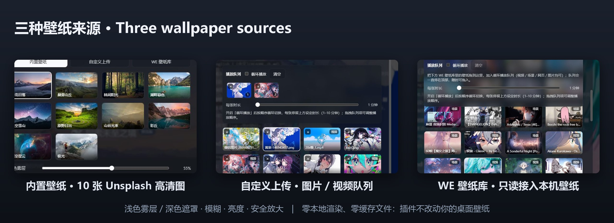

# dsh-wallpaper-bg

> v0.5.15 · MIT License

[](https://www.npmjs.com/package/dsh-wallpaper-bg)
[](https://www.npmjs.com/package/dsh-wallpaper-bg)
[](https://github.com/nishuoyang/dsh-wallpaper-bg/releases)
[](LICENSE)
[](https://dsh-plugin.org/plugins/nishuoyang/dsh-wallpaper-bg)
[](https://awesome-dsh-plugin.com)

[English](README.md) | 中文

给 [DeepSeek Harness](https://github.com/deepseek-ai/deepseek-harness)（DSH）界面加上一层**独立的动态壁纸背景**的静态双半插件——`dsh web` 网页界面和 0.2 **桌面端**（0.2.1 已复核）都适用：装好（命令行一条命令；桌面端更是只在插件页面里填个包名）、刷新页面，整个界面的底层就变成一张会动的壁纸。背景层与桌面 Wallpaper Engine 完全独立：在 DSH 里换壁纸不会动你的桌面壁纸，反之亦然。





## 功能

- **三种壁纸来源**：内置 10 张 Unsplash 高清图，即装即用；自定义上传（本地图片 / 视频，存入 IndexedDB，视频自动生成首帧缩略图）；以及只读接入本机 **Wallpaper Engine** 已安装壁纸（装配套插件 [`dsh-wallpaper-engine-api`](https://github.com/nishuoyang/dsh-wallpaper-bg/tree/main/dsh-wallpaper-engine-api#readme) 后自动发现端口），按 Steam 真实订阅清单过滤。
- **播放队列**：自定义上传与 WE 壁纸库各有独立队列，拖入壁纸循环播放，每张停留 1–10 分钟；支持拖拽排序、点选跳播、× 移除、清空，队列内容持久化到 localStorage，队列吸顶在页签顶部。
- **四种渲染**：静态图片（cover 铺满）、视频（`<video object-fit: cover>`，GPU 合成缩放）、场景（WE 自带的工坊预览图 `preview.gif` / `preview.jpg`）、网页（iframe 原生渲染 `index.html`）。
- **四项调节**：浅色雾层 / 深色遮罩（随 DSH 主题自动切换）、背景模糊度（0–20px）、背景亮度（50–150%）、安全放大（0–10%，裁掉边缘黑边）。
- **统一蓝粉配色**：蔚蓝主色 + 玫粉高亮，覆盖主题色、半透明表面、按钮、文字、链接、用户气泡与滚动条；`dsh web` 与桌面端共用同一套令牌，桌面标题栏同步。设置 → **通用设置 → 外观 → 主题配色**可随时切回「经典」黑白主色，选择会持久化。
- **原生背景开关**：主页面标题区一键清除雾层 / 遮罩与页面表面的半透明覆盖，露出完整壁纸，输入框和弹窗保持可读底色；关闭后恢复原数值。
- **同步桌面壁纸**：只读跟随当前桌面壁纸（30 秒轮询，切回 DSH 页签立即跟随），按类型渲染；多显示器自动判定并可在状态行手动指定。不修改桌面、不采样桌面画面。
- **无黑屏切换 + 下一张预热**：换壁纸采用双层交叉淡入淡出（约 0.42 秒），切换全程有画面；队列播放时会提前把下一张拉好，到点几乎立刻开始叠化。
- **零本地渲染、零缓存文件**：不解析 `scene.pkg`、不渲染场景帧、不烘焙视频、不采样桌面画面，不建 `~/.dsh-wallpaper-bg`、不落帧文件、不产 MP4。

逐项说明见 [配置说明](docs/configuration.md)。

## 安装

### 前提条件

- **DeepSeek Harness 桌面端（0.2 预览版或更新；0.2.1 已复核）**——桌面端自带 Node.js / pnpm 运行时，插件本体**无需自装 Node**；
- **或者命令行方式**（`dsh web`）：Node.js ≥ 20（`node -v` 检查）+ 能正常启动的 DeepSeek Harness；
- 可选的「WE 壁纸库」来源另有前提：Windows + 本机 Wallpaper Engine + 配套插件 `dsh-wallpaper-engine-api`（一条命令装好，不再需要 clone / `npm install` / `.bat` / 开机自启）。详见 [WE 壁纸库服务](docs/we-library-service.md)。

### 桌面端安装（无需命令行）

1. 打开**设置 → 插件**，在安装框里输入包名 `dsh-wallpaper-bg`；
2. 确认安装，按应用提示**重启桌面端**（或重载窗口）；
3. 打开**设置 → 壁纸**，挑一张壁纸即可。

已把桌面端提供的 `dsh` 命令装进 PATH 时，等价命令是：

```bash
dsh plugin --profile desktop add dsh-wallpaper-bg
```

### 命令行 / 网页版安装（`dsh web`）

```bash
dsh plugin --profile web add dsh-wallpaper-bg
```

本地开发建议直接链接仓库：`dsh plugin --profile web add link:<仓库绝对路径>`（桌面端用 `--profile desktop`）。Windows 下仓库路径不能带空格。

### 可选：WE 壁纸库来源（一条命令）

想用「WE 壁纸库」页签，再装配套插件即可（Windows + 本机已装 Wallpaper Engine）：

```bash
dsh plugin --profile web add dsh-wallpaper-engine-api      # 网页版
dsh plugin --profile desktop add dsh-wallpaper-engine-api  # 桌面端（或在 设置 → 插件 里填包名）
```

它在本机 `127.0.0.1:8088` 启动只读 WE API，随 DSH 启停；主插件会通过同源状态路由自动发现实际端口。**不再需要** clone 仓库、`npm install`、双击 `.bat` 或设置开机自启。旧的 `wallpaper-engine-api/` 目录仍保留给手动部署的用户，新用户装这个插件就行。

### 升级（为什么只跑 `add` 不会升级）

`dsh plugin … add` 转发给 `pnpm add`，而 pnpm 会保留 profile 清单里已有的版本范围，重复执行不会升级。要升级请显式指定版本：

```bash
dsh plugin --profile web add dsh-wallpaper-bg@latest    # 升到最新发布版
dsh plugin --profile web add dsh-wallpaper-bg@0.5.15     # 或锁定某个具体版本
```

> pnpm 11 只安装「发布满一天」的版本（默认 24 小时 `minimumReleaseAge`），刚发布的版本约一天内只会解析到上一个版本；写死版本号即可立刻装上。

安装、升级与本地开发的完整说明见 [安装指南](docs/installation.md)。

## 快速上手

```bash
# 1. 装进某个 profile
dsh plugin --profile web add dsh-wallpaper-bg

# 2.（可选）想用 WE 壁纸库来源，再装配套插件
dsh plugin --profile web add dsh-wallpaper-engine-api

# 3. 启动 DSH（桌面端直接打开应用即可）
dsh web
```

1. 打开**设置 → 壁纸**。
2. 选来源页签（内置壁纸 / 自定义上传 / WE 壁纸库），点选某张壁纸才应用背景——切换页签只换面板视图，不动背景。
3. 把壁纸拖进队列即可循环播放；滑杆调节雾层 / 遮罩、模糊度（0–20px）、亮度（50–150%）与安全放大（0–10%）。
4. 可选：打开**同步桌面壁纸**只读跟随桌面壁纸，或用主页面标题区的**原生背景**开关让壁纸完整透出。

确认宿主半已挂载：访问 `<DSH 地址>/dsh-wallpaper-bg/health`。

```
http://127.0.0.1:3080/dsh-wallpaper-bg/health     # dsh web（默认端口 3080）
http://127.0.0.1:19387/dsh-wallpaper-bg/health    # 桌面端（固定端口 19387）
```

> 本包另附 `dsh-wallpaper-bg` CLI（`install` / `status` / `uninstall`），面向命令行部署一键安装；它会跳过归桌面端独占的 `desktop` profile。

## 文档

| 主题 | 文档 |
| --- | --- |
| 安装、升级、本地开发 | [docs/installation.md](docs/installation.md) |
| 设置面板逐项说明、队列、筛选 | [docs/configuration.md](docs/configuration.md) |
| 可选组件：WE 壁纸库插件 `dsh-wallpaper-engine-api` | [docs/we-library-service.md](docs/we-library-service.md) · [插件 README](https://github.com/nishuoyang/dsh-wallpaper-bg/tree/main/dsh-wallpaper-engine-api#readme) |
| 症状 → 原因 → 动作 | [docs/troubleshooting.md](docs/troubleshooting.md) |
| 双半结构与路由原理 | [docs/architecture.md](docs/architecture.md) |
| 发布流程（scripts/release.ps1）与 CI 工作流 | [docs/releasing.md](docs/releasing.md) |

原理一句话：本包是 DSH **静态双半插件**，作为 profile 补丁层（bundle）组合进 host 平面——`lib/host.js` 注册同源路由（`/dsh-wallpaper-bg/asset`、`/dsh-wallpaper-bg/we`、`/dsh-wallpaper-bg/health`，并会自动发现 `dsh-wallpaper-engine-api` 插件的实际端口），`lib/client.js` 是手写的单文件浏览器 bundle，注入背景层与「壁纸」设置选项卡，`cordis.patch.yml` 把插件行插入 profile 组合，随 DSH 启动即生效。详见 [架构说明](docs/architecture.md)。

## 开源

MIT License，见 [LICENSE](LICENSE)。欢迎 issue / PR。
